# Phase 2 Report: NYC Yellow Taxi Data Cleaning, Processing, and Exploratory Analysis

## 1. Title and Team Members

**Project Title:** NYC Yellow Taxi Trip and Rideshare Analysis  
**Course:** EAS 587 – Data-Intensive Computing  
**Phase:** Phase 2 – Data Cleaning, Processing, and Exploratory Data Analysis  

**Team Members:**  
- Hwimyeong Baek  
- Colin Seiler

---

## 2. Executive Summary

In Phase 2, we cleaned and analyzed the complete NYC Yellow Taxi and High-Volume For-Hire Vehicle (Uber and Lyft) trip datasets available to the project, spanning February 2019 through December 2025. This is 83 monthly datasets in total. We used Polars with lazy execution to process both datasets at scale: each monthly file is cleaned independently, month by month, with Polars' streaming engine used when collecting and writing each cleaned file, rather than loading the full raw data into memory at once. The raw Yellow Taxi data contained 300,313,873 records; after removing records with invalid trip times, nonpositive or extreme trip distances, unreasonable trip durations, and extreme fare values, 289,073,438 records remained and around 3.74% were removed. The raw rideshare data contained 1,460,229,131 Uber/Lyft records; after the equivalent cleaning rules, 1,457,907,007 records remained with only 0.16% removed. The cleaned datasets showed clear and consistent patterns in demand by hour, day, trip distance, and pickup location across both services, along with a pronounced multi-year dip and recovery in trip volume around the 2020 covid pandemic period. Longer trips had much higher average fares in both datasets, with a clear correlation on fare cost and distance, and demand for both Yellow Taxi and rideshare trips was lowest during early morning hours and highest during the late afternoon and early evening.

---

## 3. Connection to Phase 1

In Phase 1, our project focused on using the data to study large-scale transportation patterns. Our main goal was to understand how trip demand, trip distance, fare amount, time of day, and pickup location are related.

Phase 2 continues this plan by preparing the raw taxi and rideshare data for analysis and producing the first quantitative results. This began as single-month analysis and has grown into a scalable, command-line-driven pipeline that processes the full available history (February 2019 – December 2025) for both Yellow Taxi and rideshare trips. The main research questions explored in this phase are:

1. How does taxi and rideshare demand change by hour of day and day of week?
2. How strongly are trip distance and fare amount related?
3. What do the distributions of trip distance and trip duration look like?
4. Which pickup locations have the highest activity?
5. How much does average fare change across trip-distance groups?
6. How do Yellow Taxi and rideshare patterns compare to one another, and how have they evolved year over year?

The overall direction from Phase 1 did not change, but Phase 2 helped us identify which variables are most useful for later modeling in Phase 3, and comparing Yellow Taxi to rideshare highlighted how differently the two services behave in demand, pricing, and year-over-year growth.

---

## 4. Data Cleaning and Processing

### 4.1 Data Profiling

Profiling covered the full history available to the project: 300,313,873 raw Yellow Taxi rows and 1,460,229,131 raw rideshare rows, each spanning 83 monthly Parquet files from February 2019 to December 2025 and 20+ columns. Initial profiling included schema inspection, null counts, unique-value counts, duplicate detection, numeric summaries (including p25/median/p75/p90/p95/p99), and category counts, computed independently for every monthly file and then combined.

Several data-quality issues were found in both datasets. For example, `passenger_count` was missing for roughly 17.4 million Yellow Taxi trips (the rideshare schema does not include a `passenger_count` field at all). Both datasets also contained negative fare values, zero-distance trips, extremely large trip distances, and invalid trip times where the dropoff time was earlier than or equal to the pickup time.

No exact duplicate rows were found in either dataset.

### 4.2 Cleaning Rules

We applied the following rules to every monthly file, restricted to that file's own pickup year-month:

- Keep only trips with pickup times inside the file's own year-month.
- Keep trip distances greater than 0 and less than or equal to 120 miles.
- Keep trip durations between 1 and 360 minutes.
- Require dropoff time to be later than pickup time.
- Yellow Taxi: keep fare amounts between $0 and $1,000, and total amounts between $0 and $1,000.
- Rideshare: keep only Uber (HV0003) and Lyft (HV0005) trips, with base passenger fare between $0 and $1,000.

Missing values in `passenger_count`, `RatecodeID`, and `store_and_fwd_flag` were retained rather than dropping the entire trip record. These columns are not required for every analysis, so removing all rows with missing values would discard too much otherwise useful data.

After cleaning, we removed 11,240,435 records from the yellow taxi data and 2,322,124 from the rideshare records, about 3.74% and 0.16% respectively. Rideshare trips were removed far less often, largely because Uber/Lyft's own platform-level validation already filters out most of the invalid trips that still appear in the raw Yellow Taxi feed.

### 4.3 Feature Engineering

We created several derived fields that are self explanatory for analysis, all stemming from the given pickup and dropoff times:

- `trip_duration_minutes`
- `pickup_hour`
- `pickup_weekday`
- `pickup_date`

These features made it easier to study hourly, weekday, daily, and duration-based patterns for both datasets.

### 4.4 Scalable Processing Strategy

Polars lazy scanning is the main process we used and the real hero of the project. Lazy scanning allows us to describe the filters, columns, and transformations we want before any data is actually read, instead of loading everything first and then working on it. Polars takes that description and figures out the most efficient way to satisfy it. It can skip whole sections of a file that can't contain matching rows, avoid reading columns we never use, and reorder steps for efficiency, all before execution starts. The data isn't touched until we actually ask for the result.

This is a more specific and more optimizable process than how pandas typically works around data too large for memory, which is to read the data in fixed-size chunks and loop over them in our own code. Chunking still reads and fully loads each chunk as-is, with no way to describe ahead of time which columns or rows are actually needed, so the pruning that lazy scanning gets for free has to be done by hand, chunk by chunk. This does require a real understanding of your schema prior to processing.

Cleaning is done month by month. Each of the 83 monthly Parquet files per dataset is scanned independently with Polars lazy scanning, filtered and feature-engineered on its own, and then collected and written out before the next file is processed. This per-file approach is done via `src/data_cleaning.py`, and it is what let the same cleaning logic scale from one month of Yellow Taxi data to 83 months of both services without being rewritten. The cleaned files were written to:

```text
data/processed/yellow/
data/processed/rideshare/
```

Once every month is cleaned, `src/analytics.py` opens the full set of cleaned files for a dataset as a single lazy frame (via glob) and computes the hourly, weekday, distance-group, and correlation aggregations across the combined history. Every figure and table in Sections 5 and 6 of this report was likewise computed by scanning all cleaned monthly files together — no row sampling is used anywhere in this report; even the distribution and density figures are built from binned aggregate counts over the complete dataset.

This is substantially more scalable than a standard full in-memory pandas workflow. The project's command-line pipeline (`src/pipeline.py`) now lets any combination of dataset and year be processed with the same scripts, which is what made it practical to extend this analysis from a single month of Yellow Taxi data to the full available history of both services.

---

## 5. Exploratory Data Analysis

Each figure below is shown for both datasets side by side so Yellow Taxi and rideshare patterns can be compared directly. Unless noted otherwise, figures use the full cleaned history (February 2019 – December 2025) for each dataset.

### 5.1 Trips by Pickup Hour

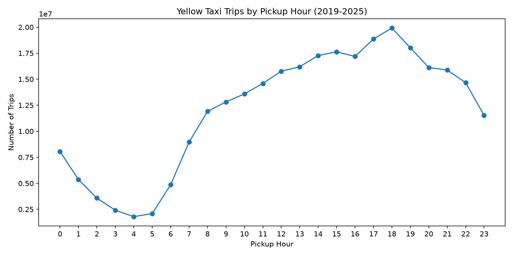
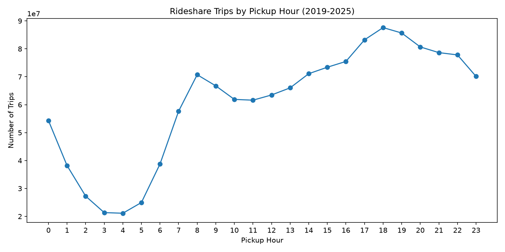

**Figure 1. Trip counts by pickup hour, Yellow Taxi (top) and rideshare (bottom).**

Demand was lowest during the early morning for both services, bottoming out at 4 AM and peaking at 6 PM. 

### 5.2 Trips by Weekday

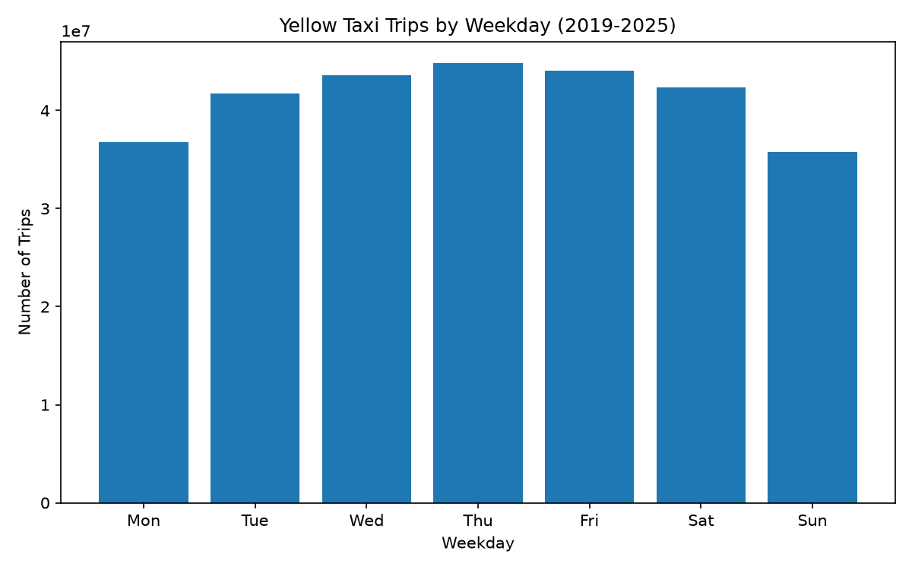
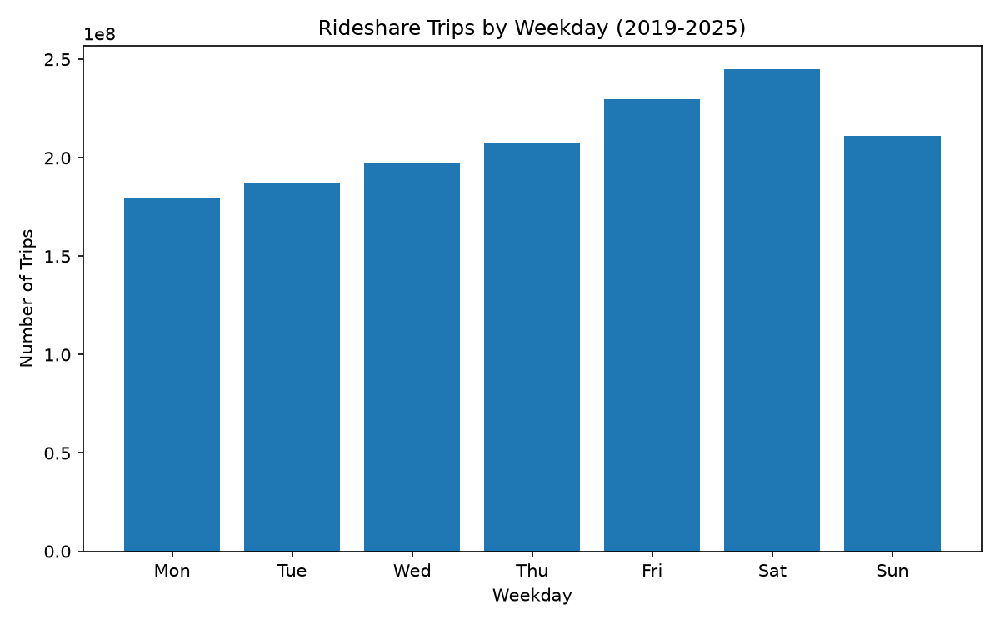

**Figure 2. Trip counts by weekday, Yellow Taxi (top) and rideshare (bottom).**

Thursday was the busiest day for Yellow Taxi and Sunday the slowest, consistent with a weekday-commute-oriented ridership. Rideshare instead peaked on Saturday and was slowest on Monday, reflecting a more weekend and leisure oriented usage pattern for Uber and Lyft.

### 5.3 Daily Trips (2019–2025)

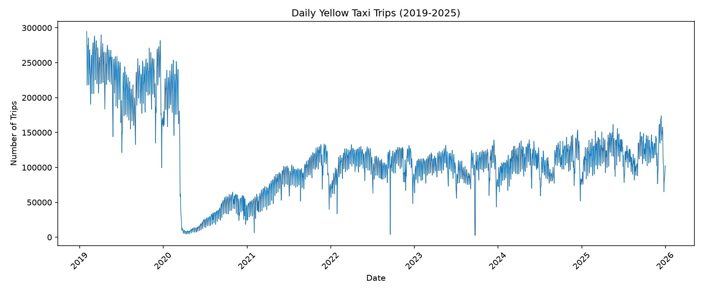
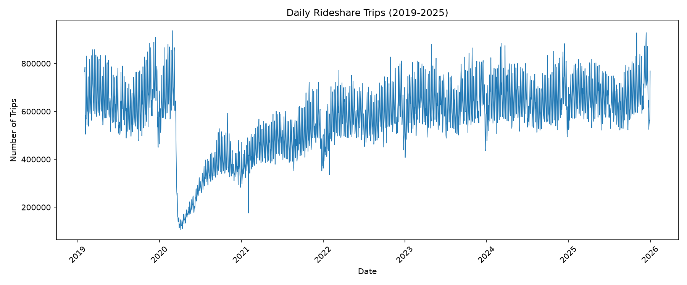

**Figure 3. Daily trip counts, Yellow Taxi (top) and rideshare (bottom).**

The daily series makes the project's expanded scale especially visible. Both datasets show a sharp, multi-month collapse in trip volume beginning in March 2020 at the onset of the COVID-19 pandemic. Yellow Taxi volume shows a general collapse following the pandemic with a clear failure to fully recover. Rideshare meanwhile appears to have recovered fully. In both cases the series seem to show consistent dips at repeated points year over year. With that in mind it will be worth performing some time series analysis to try and understand when these dips happen.

### 5.4 Distribution of Trip Distance

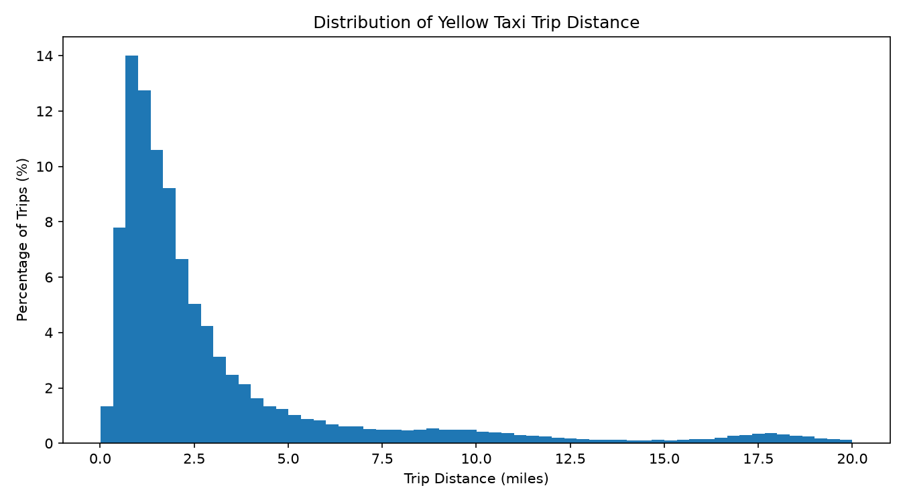
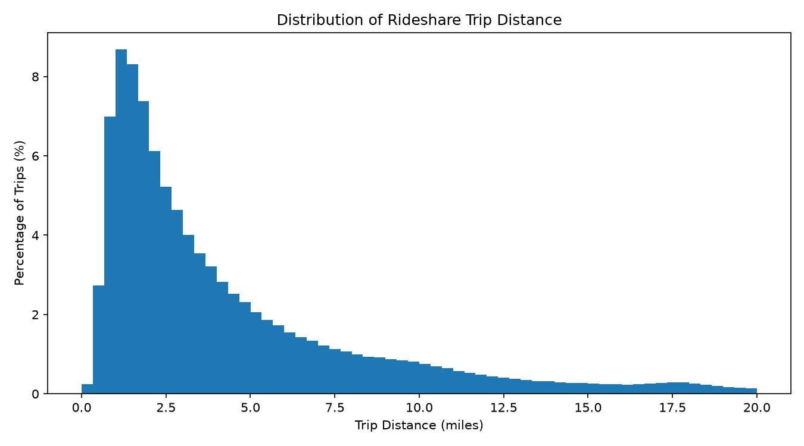

**Figure 4. Distribution of trip distance as a percentage of each dataset's own trips, Yellow Taxi (top) and rideshare (bottom).**

Values are shown as a percentage of each dataset's own trips rather than raw counts, since the rideshare dataset has roughly five times as many trips as Yellow Taxi and raw counts would make the two distributions impossible to compare on the same chart. Both trip-distance distributions are strongly right-skewed. Most trips are relatively short, with the largest concentration under approximately 3 miles for Yellow Taxi and a slightly wider spread for rideshare, which serves more of the outer boroughs. Longer trips occur much less frequently in both datasets, though a clear tail extends toward longer-distance travel.

### 5.5 Distribution of Trip Duration

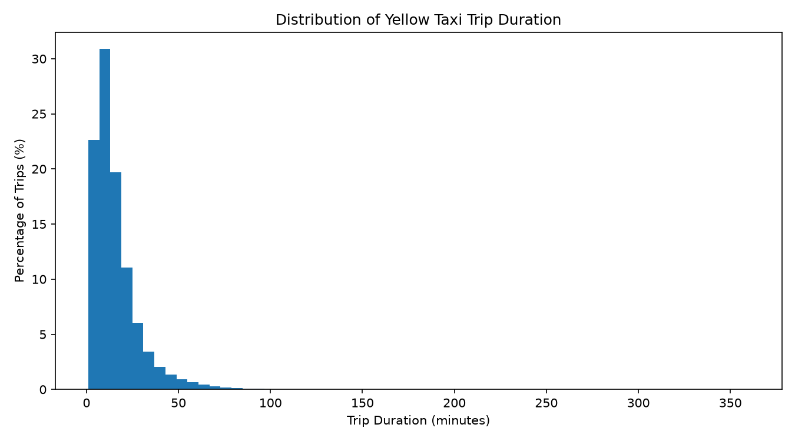
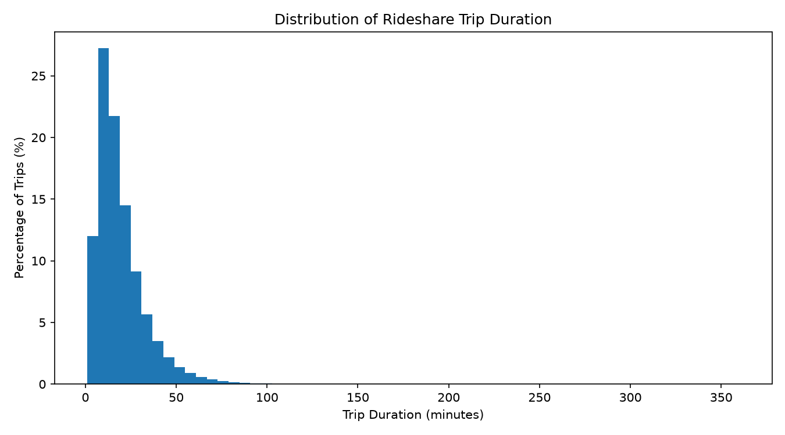

**Figure 5. Distribution of trip duration, normalized, Yellow Taxi (top) and rideshare (bottom)**

As in Figure 4, values are shown as a percentage of each dataset's own trips so the two services can be compared directly despite their very different trip volumes. Trip duration is also right-skewed for both services. Most trips are completed within a relatively short period, while long-duration trips form a much smaller tail. This pattern supports the use of robust summaries such as the median in addition to the mean.

### 5.6 Trip Distance and Fare Amount

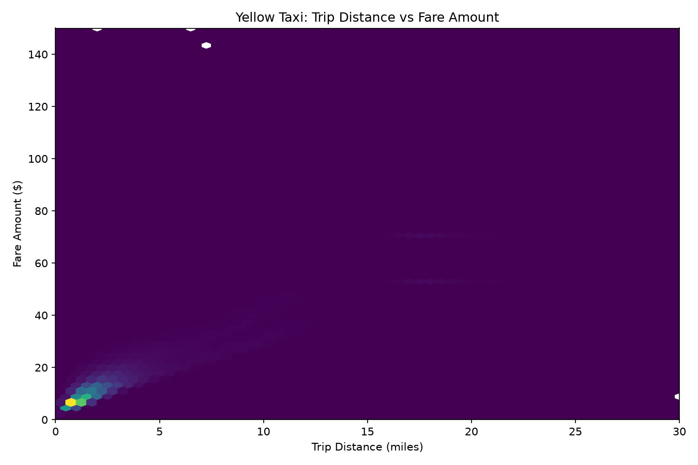
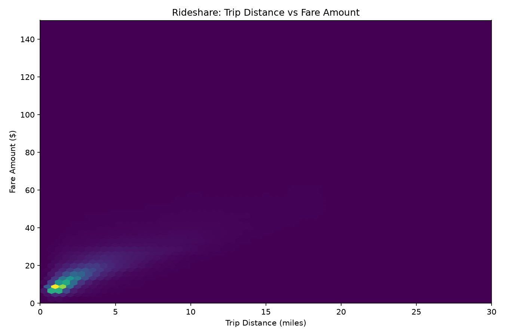

**Figure 6. Density-based view of trip distance and fare amount, Yellow Taxi (top) and rideshare (bottom).**

Fare amount generally increases as trip distance increases in both datasets. The relationship is not perfectly uniform because fares can also depend on time, surcharges, airport trips, rate codes, and (for rideshare) surge pricing. Still, the overall positive relationship is strong in both datasets and is confirmed by the correlation results in Section 6.

### 5.7 Average Fare by Trip Distance

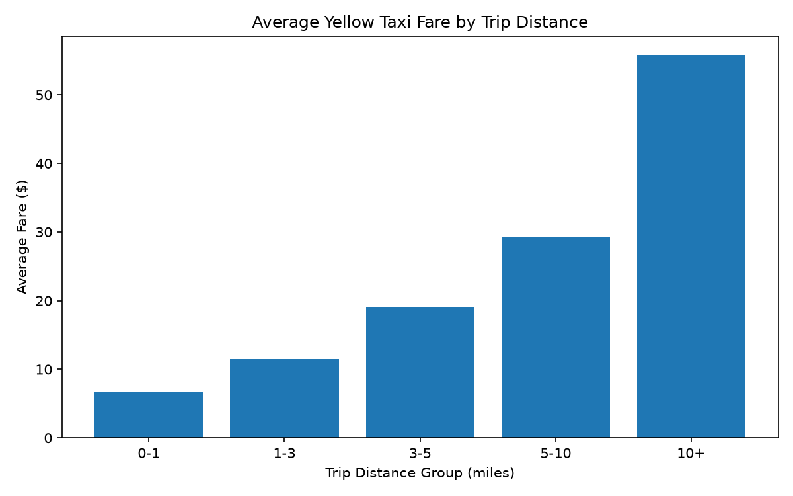
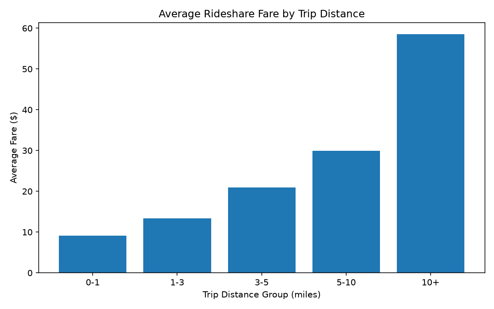

**Figure 7. Average fare by trip-distance group, Yellow Taxi (top) and rideshare (bottom).**

Average fare increased consistently across distance groups for both services:

| Distance Group | Yellow Taxi Avg. Fare | Rideshare Avg. Base Fare |
| --- | --- | --- |
| 0–1 mile | $6.69 | $9.17 |
| 1–3 miles | $11.45 | $13.38 |
| 3–5 miles | $19.14 | $20.96 |
| 5–10 miles | $29.28 | $29.91 |
| 10+ miles | $55.76 | $58.48 |

Trip distance is one of the strongest variables related to fare amount in both datasets, and rideshare base fares run consistently above Yellow Taxi metered fares at every distance band except for the 5-10 mile mark.

### 5.8 Top Pickup Locations

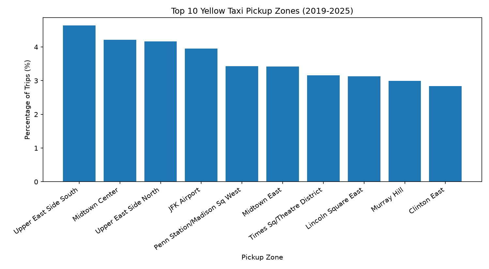
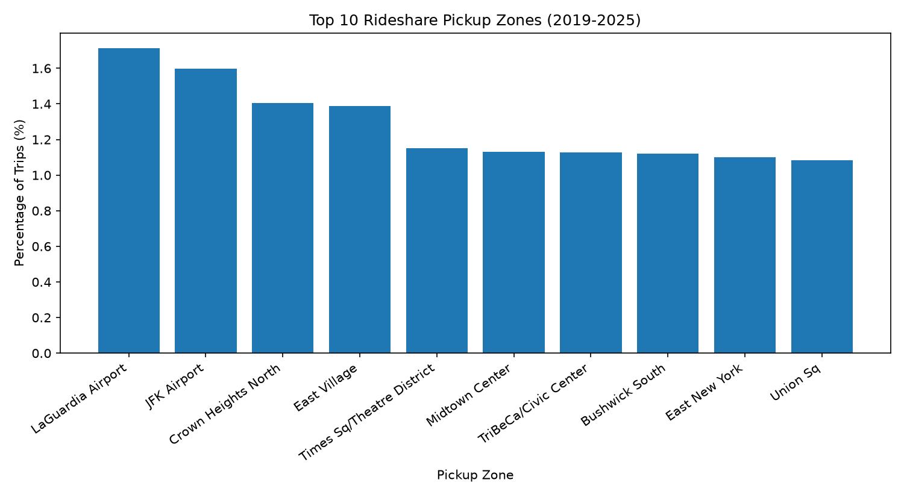

**Figure 8. Top 10 pickup zones, normalized, Yellow Taxi (top) and rideshare (bottom).**

Pickup demand is concentrated in a relatively small number of taxi zones for both services, but the top zones differ by service. Values are shown as a percentage of each dataset's own trips so the two services can be compared directly. For Yellow Taxi, a large amount of its pickups are centered in central Manhattan zones, alongside JFK Airport in 4th place (3.95%). For rideshare, the airports of LaGuardia and JFK take the first two spots while Crown Heights North, a neighbordhood in Brookly, comes in third. This shows a much larger airport and outer-borough presence than Yellow Taxi. Brooklyn zones (Crown Heights North, Bushwick South, East New York) appear in rideshare's top 10 but not Yellow Taxi's at all. Rideshare's top zones also account for a smaller share of its (much larger) total trip volume than Yellow Taxi's top zones do, reflecting a more spread-out pickup pattern across the city.

---

## 6. First Analytics Results

### Research Objective Analysis

### Research Question
How does trip distance affect taxi and rideshare fare, and how do the two services compare?

### Data Suitability
The datasets contain both trip distance and fare information for hundreds of millions of Yellow Taxi trips and over a billion rideshare trips.

### Evidence

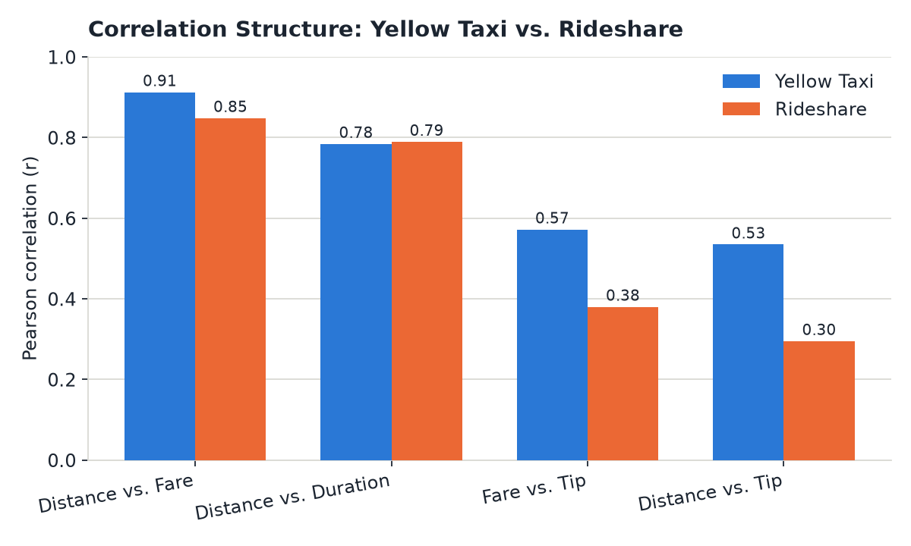

**Figure 9. Pearson correlation between key trip variables, Yellow Taxi vs. rideshare.**

| Relationship | Yellow Taxi | Rideshare |
| --- | --- | --- |
| Distance vs. Fare | 0.91 | 0.85 |
| Distance vs. Duration | 0.78 | 0.79 |
| Fare vs. Tip | 0.57 | 0.38 |
| Distance vs. Tip | 0.53 | 0.30 |

Distance is the strongest predictor of fare in both datasets, but the gap between the two services is largest in the tipping-related rows. Fare-vs-tip correlation is 0.57 for Yellow Taxi versus 0.38 for rideshare, and distance-vs-tip is 0.53 versus 0.30. Distance-vs-duration is nearly identical between the two (0.78 vs. 0.79), which makes sense since both are physically constrained by traffic and road distance regardless of which app or meter is running.

### Conclusion
The results show a strong positive relationship between trip distance and fare in both datasets, with Yellow Taxi showing a slightly stronger distance–fare correlation (0.91 vs. 0.85) and a notably stronger fare–tip relationship (0.57 vs. 0.38). This indicates that both cleaned datasets are suitable for answering the Phase 1 research objective related to fare patterns, and that tipping behavior differs meaningfully between the two services.

### Multi-Year Trends

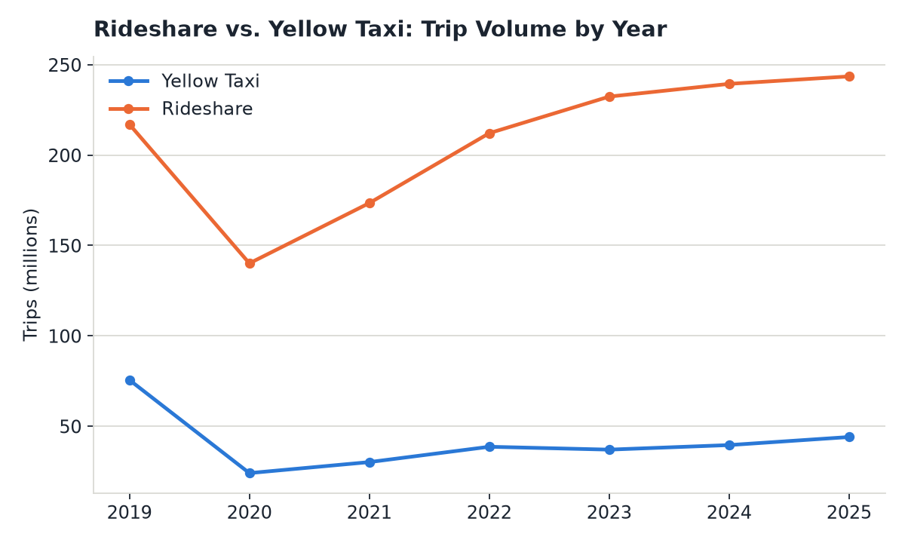

**Figure 10. Annual trip volume, Yellow Taxi vs. rideshare, 2019–2025.**

Both services lost more than two-thirds of their trip volume in 2020, but rideshare recovered faster and has grown every year since, reaching 243,513,002 trips in 2025 versus 216,992,181 in 2019. Yellow Taxi has only partially recovered, reaching 44,025,133 trips in 2025 versus 75,584,188 in 2019, almost half of it's pre-pandemic totals. It will be worth examining total subway trip counts against this data to see if more New Yorkers are shifting towards the subway. 

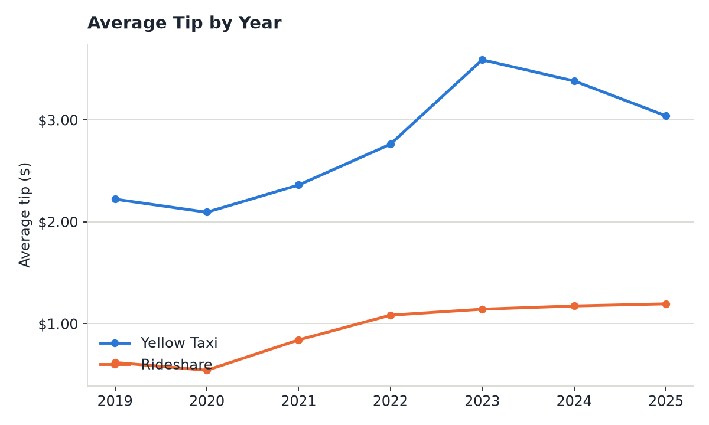

**Figure 11. Average tip by year, Yellow Taxi vs. rideshare, 2019–2025.**

Average Yellow Taxi tips rose from about $2.22 in 2019 to a peak of about $3.59 in 2023 before easing to about $3.04 in 2025. Average rideshare tips were much lower throughout, rising steadily from about $0.62 in 2019 to about $1.19 in 2025.

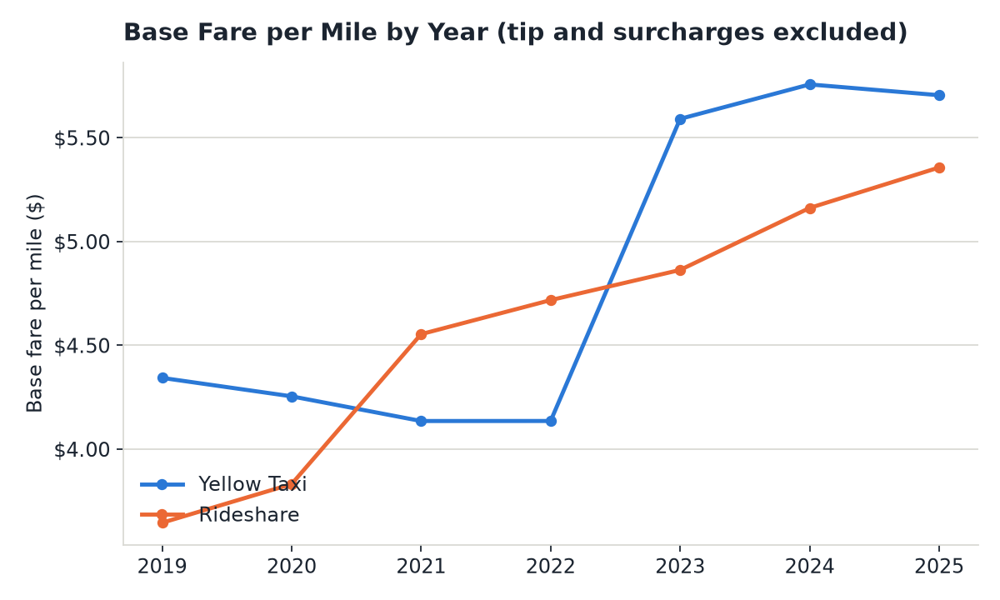

**Figure 12. Base fare per mile by year, Yellow Taxi vs. rideshare, 2019–2025.**

Base fare per mile for both services rose noticeably from 2019 to 2025. Rideshare's fare per mile increased steadily throughout the period, while Yellow Taxi's fare per mile was comparatively flat through 2022 before rising sharply in 2023, after which it has priced above rideshare on a per-mile basis.

These research questions and findings suggest that both hour, weekday, and service type should be useful features in later demand and pricing modeling.

---

## 7. Dead Ends

### Dead End 1: Using Raw Fare Values Without Additional Outlier Filtering

Our first cleaning version removed negative fare values but did not remove extremely large positive fare amounts. Before this fix, a handful of extreme values (fares in the hundreds of thousands of dollars) were enough to collapse the distance–fare correlation to near zero across a sample file, even though the grouped average-fare-by-distance pattern was clearly increasing. This mismatch showed that a small number of extreme values were distorting the correlation statistic.

We changed the cleaning rule to keep fare amounts at or below $1,000 and total amounts (Yellow Taxi) or base passenger fare (rideshare) at or below $1,000. After this adjustment, the distance–fare correlation across the full cleaned history rose to about 0.91 for Yellow Taxi and 0.85 for rideshare, both consistent with the visual patterns in Section 5.6 and Section 5.7.

### Dead End 2: Treating All Missing Passenger Information as a Reason to Drop a Trip

Across the full Yellow Taxi history, roughly 17.4 million records had missing `passenger_count` values. Dropping every record with missing passenger information would have removed millions of trips, even though those trips still contained useful information such as distance, fare, pickup time, and location.

Instead, we retained these records and excluded the missing field only from analyses where passenger count was required. This preserved much more usable data. (Rideshare trips do not include a `passenger_count` field at all, so this issue is specific to Yellow Taxi.)

---

## 8. Design Decisions

### Polars Instead of a Standard Full pandas Workflow

We chose Polars and lazy Parquet scanning because the project is intended to demonstrate data-intensive processing. Lazy execution, combined with Polars' streaming engine for the per-file cleaning writes and for this report's full-history aggregations, is what made it practical to scale the same month-by-month cleaning logic from a single month of Yellow Taxi data to 83 months of both Yellow Taxi and rideshare data (over 1.7 billion raw rows combined) without rewriting it.

### Retaining Missing Categorical Values

Instead of dropping every record with a missing value, we kept rows where missing information was limited to fields such as passenger count or rate code. This decision preserved useful trip-level data for time, distance, location, and fare analyses.

### Outlier Thresholds

We used explicit thresholds for distance (≤120 miles), trip duration (1–360 minutes), fare amount, and total amount (≤$1,000). The goal was to remove clearly unrealistic records while keeping normal long-distance or high-fare trips. We compared the analytics before and after this filtering and found that extreme fare values had a large effect on correlation results.

### Binned Aggregation for Dense Visualizations

Plotting all 289 million Yellow Taxi trips or 1.46 billion rideshare trips as individual points was not feasible for the distance, duration, and distance–fare figures. Instead, each value was assigned to a bin (or, for the distance–fare figure, a 2D grid cell), and Polars computed the count per bin across the complete dataset. Matplotlib then rendered those exact bin counts, so every figure in this report reflects the full dataset rather than a subset of it.

---

## 9. Reproducibility Statement

The Phase 2 workflow is organized so that the raw data can be downloaded, profiled, cleaned, processed, and analyzed using documented, command-line-driven Python scripts.

The main files are:

- `src/data_access.py`
- `src/data_profile.py`
- `src/data_cleaning.py`
- `src/analytics.py`
- `src/pipeline.py`
- `data/processed/yellow/*.parquet`
- `data/processed/rideshare/*.parquet`

Every figure and statistic in this report is computed from the complete cleaned dataset for each service. The full cleaning and analytics workflow can be reproduced end-to-end with `python src/pipeline.py --yellow_taxi --rideshare`.

We have run and processed this cleanly, and it was reproducible in an untouched system.

Considering the ridiculous amount of storage space required, the current python files have been edited to only run on 2025 when downloaded and processed on a local computer. This was a design choice so that our professor or grader would not have to make that much room within their system. If you would like to run it on all files, you can edit the `YEARS` variable and add in the years from 2019 to 2025 as a list.

---

## 10. References

1. NYC Taxi & Limousine Commission. *TLC Trip Record Data*.  
2. John W. Tukey. *Exploratory Data Analysis*. Addison-Wesley, 1977.  
3. Polars Documentation.  
4. Matplotlib Documentation.